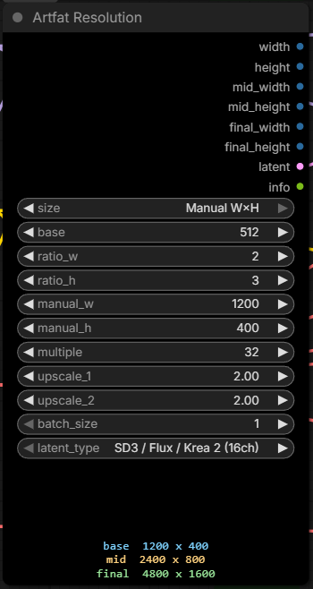
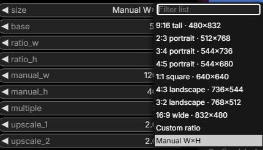
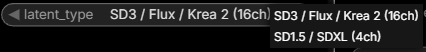

# ComfyUI-Artfat-Resolution

A tiny, **elastic** resolution picker for ComfyUI built for **low-base + upscale** workflows
(Krea 2 / Selfism / H3), but works anywhere. Four ways to set the size, two upscale stages, an
optional **image/mask resize** to the computed size, and a **live readout** so you know the
final file size before you render.

No canvas, no dozen buttons — clean controls and a real-time readout.



## Node: **Artfat Resolution**

### Four modes (one `size` dropdown)



- **Preset size** — pick a ready `W×H` (e.g. `2:3 portrait · 512×768`). Beginner-friendly.
- **Custom ratio** — set `ratio_w:ratio_h` + `base` short side (e.g. `3:1` banners).
- **Megapixels · aspect** — set a target area in `megapixels` + an `mp_aspect`; the node solves
  `W×H` for that pixel budget and snaps both sides to `multiple`
  (e.g. `0.98 MP` @ `9:16` → `736×1312`). `mp_aspect = custom (ratio_w:ratio_h)` uses the
  `ratio_w` / `ratio_h` widgets instead of the named list.
- **Manual W×H** — type an **exact** `manual_w` / `manual_h`. **Not snapped** — exact stays exact (e.g. `1200×400`).

`mp_aspect` list: `9:16`, `2:3`, `3:4`, `4:5`, `1:1`, `5:4`, `4:3`, `3:2`, `16:9`, `21:9`, `custom`.

### Two upscale stages
- `upscale_1`, `upscale_2` — decimal multipliers. **`1.0` = off** (true passthrough, no snapping).
- The node computes the full chain **base → mid (×up1) → final (×up2)** — matches a two-pass
  image **or video** upscale pipeline, so you see the final size up front.
- Since v3 the mid/final sizes are **not output sockets** — they appear in `info` and in the
  on-canvas readout only.

### Optional image / mask resize
- Connect `image` and/or `mask` (both optional inputs) and the node resizes them to the
  **BASE** `width×height` — not to mid/final.
- `scale_method` — `lanczos` (default), `nearest-exact`, `bilinear`, `area`, `bicubic`.
  Passed straight to `comfy.utils.common_upscale`.
- `crop` — `center` = cover-crop keeping aspect; `disabled` = stretch to exact `W×H`.

### Other inputs
- `multiple` — snap sides to **8 / 16 / 32 / 64** (16/32 safe for Krea 2 / Qwen / H3). Ignored for the exact side in Manual mode.
- `base` — short side, used **only** in Custom ratio mode.
- `batch_size` — for the empty `LATENT` output.
- `latent_type` — `SD3 / Flux / Krea 2 (16ch)` or `SD1.5 / SDXL (4ch)`. Only matters if you use the `latent` output — match it to your model.



### Outputs

| # | Name | Type | Notes |
|---|------|------|-------|
| 0 | `width` | `INT` | base width |
| 1 | `height` | `INT` | base height |
| 2 | `image` | `IMAGE` | connected image resized to base `W×H`; **`None` if nothing is connected** |
| 3 | `mask` | `MASK` | connected mask resized to base `W×H`; **`None` if nothing is connected** |
| 4 | `latent` | `LATENT` | empty latent at base size (drop your `EmptyLatentImage`) |
| 5 | `info` | `STRING` | e.g. `512x768 -> 960x1472 -> 1920x2944 · 0.39 MP` |

`info` lists only the stages that actually change the size, and always ends with the **base**
megapixel count. Wire it into a text node for a readout / filename.

The node also draws the `base → mid → final` chain live at the bottom.

## Gotchas

- **Breaking vs v2** — the outputs changed. v2 was
  `width, height, mid_width, mid_height, final_width, final_height, latent, info` (8 sockets);
  v3 is `width, height, image, mask, latent, info` (6). ComfyUI wires outputs **by index**, so
  v2 workflows will come back mis-linked — re-wire the node after updating.
- `image` / `mask` outputs are `None` when the matching input is not connected. Only wire them
  downstream when you actually feed something in.
- The image path uses `image[..., :3]` — **alpha is dropped**, the output is always 3-channel RGB.
- `scale_method = lanczos` on a **mask** goes through ComfyUI's PIL lanczos path, which
  round-trips through 8-bit. For soft / precise masks prefer `bilinear` or `area`.
- The `latent` output is built as `height // 8, width // 8`. In Manual mode with sides that are
  not multiples of 8 this silently floors — use a snapping mode if that latent feeds a sampler.
- Megapixels mode snaps both sides with round-to-`multiple`, so the realised area is *near* the
  requested MP, not exact. The value actually reached is printed in `info`.
- The on-canvas live readout (`web/artfat_resolution.js`) mirrors the Preset / Custom ratio /
  Manual math only — in **Megapixels** mode it draws nothing. The node itself still computes
  correctly; read the numbers from the `info` output.

## Install

**Option 1 — ComfyUI-Manager (easiest)**
`Custom Nodes Manager → Install via Git URL →`
`https://github.com/artfat-creator/ComfyUI-Artfat-Resolution`

**Option 2 — git clone**
```bash
cd ComfyUI/custom_nodes
git clone https://github.com/artfat-creator/ComfyUI-Artfat-Resolution.git
```
Then **restart ComfyUI** (a browser refresh is not enough — the node registers on server start).

No extra Python dependencies — uses `torch` and `comfy.utils`, both already provided by ComfyUI.

## License
MIT © artfat-creator
